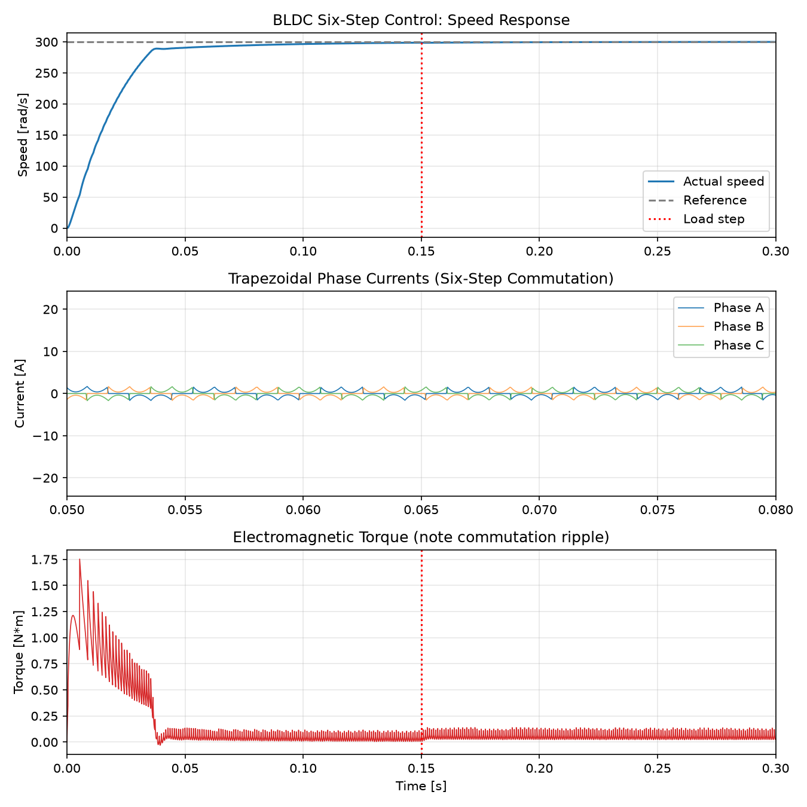

# BLDC Motor: Six-Step Trapezoidal Control Simulation with Anti-Windup PI Speed Loop

A first-principles dynamic simulation of a three-phase Y-connected Brushless DC (BLDC) motor driven by 120° six-step commutation, modeled in Python using numerical integration (`scipy.integrate.solve_ivp`).



---

## Technical Overview & Mathematical Model

### 1. Electrical Dynamics (Conduction Line Equivalent)
During 120° six-step trapezoidal commutation, exactly two phases conduct simultaneously while the third floats:
- Conducting line resistance: $R_{\text{line}} = 2R_{\text{ph}}$
- Conducting line inductance: $L_{\text{line}} = 2L_{\text{ph}}$

The terminal current differential equation is:
$$\frac{di_{\text{line}}}{dt} = \frac{V_{\text{applied}} - i_{\text{line}} R_{\text{line}} - (e_{\text{pos}} - e_{\text{neg}})}{L_{\text{line}}}$$

Where $e_{\text{pos}}$ and $e_{\text{neg}}$ are the instantaneous trapezoidal back-EMF voltages of the active conducting phases.

### 2. Mechanical Dynamics
$$\frac{d\omega_m}{dt} = \frac{T_e - B \omega_m - T_L}{J}$$
$$\frac{d\theta_m}{dt} = \omega_m$$

Where:
- $J$: Rotor moment of inertia ($1.0 \times 10^{-4} \text{ kg}\cdot\text{m}^2$)
- $B$: Viscous friction coefficient ($1.0 \times 10^{-4} \text{ N}\cdot\text{m}\cdot\text{s}$)
- $T_L$: External load torque step ($0.02 \text{ N}\cdot\text{m}$ applied at $t = 0.15\text{ s}$)
- $T_e$: Electromagnetic torque calculated from instantaneous phase power balance:
  $$T_e = \frac{e_a i_a + e_b i_b + e_c i_c}{\omega_m}$$

### 3. Six-Step Commutation Logic
Sector lookup uses electrical angle $\theta_e = P \cdot \theta_m$ with a $150^\circ$ alignment offset to align conduction flat-tops with maximum back-EMF:

| Sector | Electrical Angle Range | Active Phase (+) | Active Phase (-) | Floating Phase |
| :---: | :---: | :---: | :---: | :---: |
| **0** | $0^\circ - 60^\circ$ | A | B | C |
| **1** | $60^\circ - 120^\circ$ | A | C | B |
| **2** | $120^\circ - 180^\circ$ | B | C | A |
| **3** | $180^\circ - 240^\circ$ | B | A | C |
| **4** | $240^\circ - 300^\circ$ | C | A | B |
| **5** | $300^\circ - 360^\circ$ | C | B | A |

### 4. Speed Controller with Anti-Windup
The outer speed regulation loop utilizes a Proportional-Integral (PI) architecture:
$$\text{Duty} = \text{clip}\left(K_p e(t) + K_i \int e(t) dt, -1.0, 1.0\right)$$
- **Clamping Anti-Windup:** Error integration freezes whenever the duty output saturates in the direction of the error, eliminating large overshoot transients.

---

## Motor & Drive Parameters

| Parameter | Symbol | Value | Unit |
| :--- | :---: | :---: | :---: |
| DC Bus Voltage | $V_{\text{dc}}$ | 24.0 | V |
| Phase Resistance | $R$ | 0.5 | $\Omega$ |
| Phase Inductance | $L$ | 0.5 | mH |
| Back-EMF Constant | $K_e$ | 0.01 | $\text{V}\cdot\text{s/rad}$ |
| Pole Pairs | $P$ | 4 | - |
| Rotor Inertia | $J$ | $1.0 \times 10^{-4}$ | $\text{kg}\cdot\text{m}^2$ |
| Viscous Damping | $B$ | $1.0 \times 10^{-4}$ | $\text{N}\cdot\text{m}\cdot\text{s}$ |
| Proportional Gain | $K_p$ | 0.06 | - |
| Integral Gain | $K_i$ | 1.20 | - |

---

## Simulation Results & Dynamic Performance

- **Speed Reference Step:** $0 \rightarrow 300 \text{ rad/s}$ ($~2865 \text{ RPM}$)
- **Rise Time (to 90%):** $\approx 36.4 \text{ ms}$
- **Overshoot:** $< 0.5\%$ (effective anti-windup clamping)
- **Settling Time (2% band):** $\approx 42.1 \text{ ms}$
- **Load Disturbance Response:** A $0.02 \text{ N}\cdot\text{m}$ load torque step at $t = 0.15\text{ s}$ produces a minimal speed dip ($< 2.5 \text{ rad/s}$) with rapid recovery ($< 15 \text{ ms}$).
- **Commutation Ripple:** Characteristic $6\times$ electrical frequency torque ripple observed during phase handoffs, inherent to 120° trapezoidal control.

---

## File Structure

```text
bldc-motor-control-simulation/
├── bldc_sim.py            # Complete physics engine and Runge-Kutta solver
├── bldc_sim_results.png   # Response curves (Speed, Phase Currents, Torque)
├── requirements.txt       # Dependencies
├── .gitignore
└── README.md              # Technical documentation & control derivation
Quickstart Guide
1. Clone & Set Up
Bash
git clone [https://github.com/YOUR_GITHUB_USERNAME/bldc-motor-control-simulation.git](https://github.com/YOUR_GITHUB_USERNAME/bldc-motor-control-simulation.git)
cd bldc-motor-control-simulation
python -m venv venv
source venv/bin/activate  # On Windows: venv\Scripts\activate
pip install -r requirements.txt
2. Run the Simulation
Bash
python bldc_sim.py
This solves the coupled differential equations using adaptive Runge-Kutta 4(5) (RK45), prints transient performance metrics to the console, and regenerates bldc_sim_results.png.

Model Assumptions & Future Work
Simplifications Modeled: Ideal 120° conduction (instantaneous current commutation without freewheeling diode decay periods); voltage duty treated as an averaged fraction without high-frequency PWM carrier switching.

Next Steps: Expansion to Field Oriented Control (FOC / Park-Clarke transforms) and Space Vector PWM (SVPWM) to suppress commutation torque ripple.

Author
Anushka Bhatt

B.Tech Mechanical Engineering
https://github.com/annikota26-ship-it
